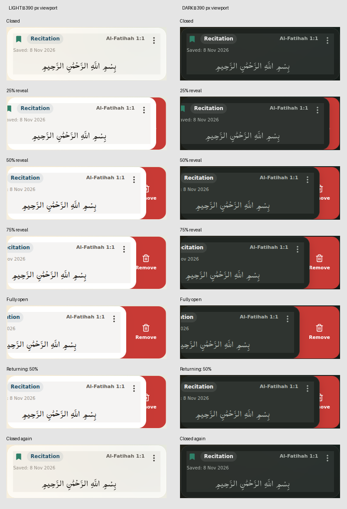

# Ayah press and swipe interaction audit

Branch: `feature/tadabbur-gemini-foundation`  
Starting commit: `4b634a8d8df74fb8bae6d5440e09a997d354efb9`

## Root causes

### Long press

- `QuranLine.jsx`, `startTouchPress`/`beginLongPress`/`finishPress`: touch started a timer, while the concurrently delivered pointer lifecycle could cancel the same timer or reset the same flags. Native `contextmenu` also independently opened selection. There were three entry/lifecycle paths rather than one owner.
- `QuranLine.jsx`, `onClick`: after the timer opened the overlay, `interactionsBlocked` became true. The click handler checked that new value **before** consuming the long-press click and called `onBlockedInteraction`, which led to `ReaderScreen.dismissVisibleReaderUi()` closing the newly opened toolbar. This explains an opening toolbar disappearing on release even when hit testing succeeded.
- `AyahActionSheet.jsx`: backdrop click dismissal did not distinguish a new outside interaction from a compatibility click following the opening hold.
- `ayahDomRange.js`, `getWordAtRenderedPoint`: spaces between word boxes returned null. The new bounded fallback only resolves gaps between words belonging to the same authoritative verse; ambiguous inter-ayah gaps remain unselected.
- Zustand `openAyahSheet`/`closeAyahSheet` retain selection until explicitly changed. No autonomous state reset or stacking defect was found in the inspected path. Visible chrome already permitted selection; the fix preserves that behavior.

### Swipe

- `SwipeActions.jsx` and `shared-surfaces.css`: release removed the live offset immediately, while only the foreground transform had a CSS transition. The gradient and action visibility jumped to the destination instead of following the actual moving foreground.
- The straight gradient boundary did not fill the complement of the foreground's curved trailing corners. A rectangular reveal cannot describe the exposed rounded geometry.
- Foreground opacity depended on open/drag class switches, so it could return to glass before the closing transform completed.
- `tabs.css` made `.tab-card.is-swiped` span both grid columns on tablet/desktop. Opening/closing therefore changed card width.
- Home and tab owners repeated action geometry. Home's foreground used 23px corners while legacy wrapper rules also specified 18px.

## Implementation

- `QuranLine` now has one Pointer Event press state: idle, pending, scrolling, activated, completed/cancelled. It captures the pointer, opens at 430ms, cancels pending holds after movement or browser cancellation, and consumes the opening click before checking overlay blocking.
- Reader page gestures also use Pointer Events for touch and mouse, with vertical cancellation and a hold guard. Native vertical scrolling remains enabled.
- Toolbar outside dismissal uses a new pointer-down on the backdrop. Release, cancellation and synthetic clicks from the opening gesture cannot dismiss it. Toolbar/submenu actions retain their existing behavior.
- Swipe animation has one numeric offset. Every frame updates translation, opacity and a curved reveal mask together. The stationary red layer is clipped to the complement of the translated foreground's trailing corners, then clipped again by the outer card boundary. Closed offset produces an empty mask.
- Shared geometry owns translation and action positioning. Home supplies its 23px radius through a token; other cards retain 18px. The tablet grid expansion was removed. No new `!important`, scaling, width animation or global scrolling prevention was introduced.

## Verification

- `npm run lint`: passed.
- `npm test`: 25/25 passed.
- `npm run build`: passed.
- Mobile Chromium: `gesture-lifecycle`, `coordinated-ui-fixes`, and `reader-spread.spec`: 33/33 passed.
- Desktop Chromium: `gesture-lifecycle` and `swipe-consumers`: 12/12 passed.
- Additional CDP touch cancellation test: 1/1 passed. Cancellation before the threshold clears pending selection; cancellation after activation preserves the toolbar. A subsequent contextmenu event does not alter selection.
- Total successful final browser checks: 46. Coverage includes touch and mouse, mobile/tablet/desktop sizes, both themes, repeat holds, correct references, continuation ayah 2:54 on page 8, markers, translation taps, submenu interaction, outside dismissal, page swiping, rotation, and all five swipe consumers.
- Pixel checks: 84 screenshots across seven reveal/return positions, two themes, three viewport widths and two browser projects. Checked empty closed masks, red outside foreground/outer rounded boundaries, and gaps in the revealed top/bottom corners, with a 2px antialiasing tolerance. All passed.
- Foreground width/height stayed constant at each sampled position. No new `!important` declarations; `git diff --check` passed.

Browser commands used `PLAYWRIGHT_CHROMIUM_EXECUTABLE=/tmp/quran-chromium/chromium`. The path is environment-specific; normal environments can use Playwright's installed Chromium.

The screenshots show closed, 25%, 50%, 75%, fully open, returning to 50%, and closed again. Full-resolution individual images are included in the delivery archive.

## Limits

Tests use headless Linux Chromium with real browser mouse input and CDP touch input, including mobile/tablet viewport emulation. They are not physical Android-device verification. The default Playwright browser download returned an invalid archive, so the run used locally extracted Chromium 153 with the existing executable-path configuration.

No screenshots/video were attached to the current request. The investigation used the supplied observations, branch code and fresh browser recordings/screenshots. Production recitation/network behavior was not exhaustively audited; relevant regression tests use the repository's fixtures. Existing build notices about large chunks and stale Browserslist data remain unrelated to this change.
